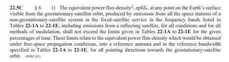
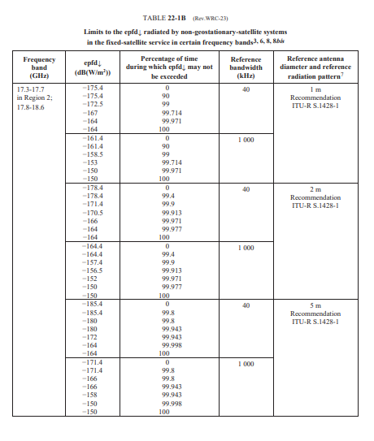
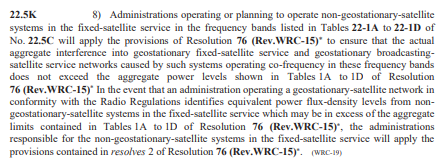
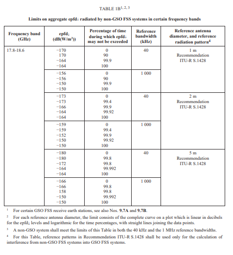

# ITU GSO保护条款整理：22.5C、22.5K及两类EPFD限值表

整理日期：2026-11-17。

依据：用户提供的四张官方文件截图、此前讨论及已检索的ITU官方原文。中文为研究用途翻译与解释，不替代正式法律文本。图片已复制到同目录的“ITU_GSO保护条款截图_20261117”文件夹，不依赖临时剪贴板路径。

## 1. 先分清四部分的关系

| 内容 | 管什么 | 本研究中的用途 |
|---|---|---|
| **22.5C** | 一个NGSO系统全部相关空间发射源对GSO的下行EPFD保护要求 | 确定单系统评价的基本原则、参考条件与时间百分比要求 |
| **Table 22-1B** | 本研究频段内，单系统EPFD↓的限值曲线 | Starlink、OneWeb分别按对应配置评价 |
| **22.5K** | 多个同频NGSO系统共同造成的实际聚合干扰 | 引出第76号决议的多系统保护要求及协调处理机制 |
| **Resolution 76, Annex 1, Table 1B** | 多系统聚合EPFD↓限值曲线 | 评价同一窗口、接收点、指向和时刻下的Starlink+OneWeb合计贡献 |

**单系统不是单颗卫星。** Starlink单系统结果仍需聚合该系统所有纳入模型、在同一参考窗口有贡献的活动发射源；OneWeb同理。多系统结果是在同样评价条件下再合并不同系统贡献。

## 2. 条款22.5C：单系统下行保护的基本要求

### 2.1 原文截图

### 2.2 中文翻译

**22.5C　第6款　1）**

在地球表面任何能够看见地球静止卫星轨道的位置，由一个非地球静止卫星固定卫星业务系统中所有空间电台，在表22-1A至表22-1E所列频段内的发射所产生的**等效功率通量密度²（EPFD）**，包括反射式卫星的发射，在任何条件下、采用任何调制方式时，均不得超过这些表中针对相应时间百分比规定的限值。

这些限值对应于：在**自由空间传播条件**下，使用表22-1A至表22-1E规定的**参考天线和参考带宽**，并考虑朝向地球静止卫星轨道的**所有指向方向**时，所得到的等效功率通量密度。

（WRC-03）

### 2.3 用人话解释与建模作用

一套NGSO系统的卫星可以向地面发信号，但共同漏进GSO参考接收天线的干扰不能超过规定。检查时应统一天线、参考带宽和传播条件，并考虑时间变化、地面位置与指向，不能只看一颗卫星或一个较有利的站点。

对本项目：固定的12个GSO保护接收关联可用来研究动态计算，不足以代表所有地面位置和指向的系统合规检查。当前只建模选中的馈电发射集合，也不等于某运营商所有实际发射波束。不得把61帧通过某些门限写成整个系统满足22.5C。

## 3. Table 22-1B：单系统EPFD↓限值

### 3.1 标题、版本及原图

**表22-1B（WRC-23修订）：非地球静止卫星固定卫星业务系统在某些频段内产生的下行等效功率通量密度（EPFD↓）限值。** 标题带脚注3、6、8、8bis；参考天线列带脚注7。

截图适用频段：**17.3–17.7GHz（第二区）；17.8–18.6GHz**。当前研究使用后者，不能把前者的地区条件直接扩展为全球。

以下将原表两种参考带宽并列；单位均为dB(W/m²)，数值对应列明的参考带宽。“时间比例”是**不得超过该限值的时间比例**。

### 3.2 1米参考天线：ITU-R S.1428-1

| 40kHz参考带宽限值 | 1MHz参考带宽限值 | 不得超过该限值的时间比例 |
|---:|---:|---:|
| −175.4 | −161.4 | 0% |
| −175.4 | −161.4 | 90% |
| −172.5 | −158.5 | 99% |
| −167 | −153 | 99.714% |
| −164 | −150 | 99.971% |
| −164 | −150 | 100% |

### 3.3 2米参考天线：ITU-R S.1428-1

| 40kHz参考带宽限值 | 1MHz参考带宽限值 | 不得超过该限值的时间比例 |
|---:|---:|---:|
| −178.4 | −164.4 | 0% |
| −178.4 | −164.4 | 99.4% |
| −171.4 | −157.4 | 99.9% |
| −170.5 | −156.5 | 99.913% |
| −166 | −152 | 99.971% |
| −164 | −150 | 99.977% |
| −164 | −150 | 100% |

### 3.4 5米参考天线：ITU-R S.1428-1

| 40kHz参考带宽限值 | 1MHz参考带宽限值 | 不得超过该限值的时间比例 |
|---:|---:|---:|
| −185.4 | −171.4 | 0% |
| −185.4 | −171.4 | 99.8% |
| −180 | −166 | 99.8% |
| −180 | −166 | 99.943% |
| −172 | −158 | 99.943% |
| −164 | −150 | 99.998% |
| −164 | −150 | 100% |

### 3.5 如何理解及使用

例如1米、40kHz时：至少90%的时间EPFD↓不高于−175.4dB(W/m²)，任何时刻不得超过100%行的−164dB(W/m²)。0%行是曲线端点，不表示干扰必须始终低于该值。原表重复百分比和节点全部保留，不能删除后自行平滑。

本表作用是检查各NGSO系统的单系统贡献，不能直接用来评价两系统合计。不能把100MHz总干扰同40kHz限值比较，不能把−12.2dB I/N作为本表的替代。

截图未包含其全部脚注，不能将下文第76号决议表1B的脚注直接当作本表脚注。此前官方全文已确认本表脚注22.5C.7要求同时满足40kHz和1MHz两种参考带宽。其他脚注及完整曲线判定仍应随官方全文一并查阅。

## 4. 条款22.5K：多系统聚合干扰与协调处理

### 4.1 原文截图

### 4.2 中文翻译

**22.5K　第8项）**

对于在第22.5C款表22-1A至表22-1D所列频段内运行或计划运行非地球静止卫星固定卫星业务系统的主管部门，应适用第76号决议（WRC-15修订版）*的规定，以确保这些系统在上述频段内同频运行时，对地球静止卫星固定卫星业务网络和地球静止卫星广播卫星业务网络造成的**实际聚合干扰**，不超过该决议表1A至表1D规定的聚合功率水平。

如果某主管部门运行的地球静止卫星网络符合《无线电规则》，并发现非地球静止卫星固定卫星业务系统产生的等效功率通量密度可能超过第76号决议表1A至表1D规定的聚合限值，那么，负责这些非地球静止卫星系统的主管部门应执行该决议“决定”（resolves）第2项规定的措施。

（WRC-19）

### 4.3 用人话解释与版本说明

每个系统分别符合单系统要求，不保证多个系统一起工作时总干扰也满足聚合要求。如果总干扰超过对应要求，相关主管部门需要按决议程序采取措施处理。

**截图中明确引用WRC-15版决议，并带星号；星号说明不在截图内。** 本次另外找到的是第76号决议WRC-23修订版，下面表1B按用户提供的该版本截图整理。保留这一区别，不把22.5K原句中的WRC-15擅改为WRC-23，也不宣称已完成两个版本所有条文差异核查。

## 5. 第76号决议附件1 Table 1B：多系统聚合限值

### 5.1 标题与原图

**表1B¹、²、³：非地球静止卫星固定卫星业务系统在某些频段内产生的聚合下行等效功率通量密度（EPFD↓）限值。**

来源：Resolution76 (Rev.WRC-23)，Annex1，第6页（标注RES76-6；独立PDF印刷页98）。适用频段：**17.8–18.6GHz**。

### 5.2 1米参考天线：ITU-R S.1428

| 40kHz参考带宽限值，dB(W/m²) | 1MHz参考带宽限值，dB(W/m²) | 不得超过该限值的时间比例 |
|---:|---:|---:|
| −170 | −156 | 0% |
| −170 | −156 | 90% |
| −164 | −150 | 99.9% |
| −164 | −150 | 100% |

### 5.3 2米参考天线：ITU-R S.1428

| 40kHz参考带宽限值，dB(W/m²) | 1MHz参考带宽限值，dB(W/m²) | 不得超过该限值的时间比例 |
|---:|---:|---:|
| −173 | −159 | 0% |
| −173 | −159 | 99.4% |
| −166 | −152 | 99.9% |
| −164 | −150 | 99.92% |
| −164 | −150 | 100% |

### 5.4 5米参考天线：ITU-R S.1428

| 40kHz参考带宽限值，dB(W/m²) | 1MHz参考带宽限值，dB(W/m²) | 不得超过该限值的时间比例 |
|---:|---:|---:|
| −180 | −166 | 0% |
| −180 | −166 | 99.8% |
| −172 | −158 | 99.8% |
| −164 | −150 | 99.992% |
| −164 | −150 | 100% |

### 5.5 本表脚注完整翻译

1. 对于某些GSO固定卫星业务接收地球站，还应参见第9.7A和9.7B款。
2. 对于每种参考天线口径，限值由一条完整曲线构成：EPFD↓采用以分贝表示的线性刻度，时间百分比采用对数刻度，各数据点之间用直线连接。
3. 非GSO系统必须同时满足本表中40kHz和1MHz两种参考带宽下的限值。
4. 本表中的ITU-R S.1428参考方向图，仅用于计算NGSO FSS系统对GSO FSS系统的干扰。

### 5.6 本表作用

用于评价多个同频NGSO系统共同产生的EPFD↓。本项目可分别保存Starlink、OneWeb贡献，在相同参考窗口、GSO参考天线、位置、指向及同一时刻下，先在线性功率域相加，再转成dB。不要相加两个系统的dB值，也不要将两系统各自最坏时刻的数值直接相加，当成同时发生的实际聚合。

例如1米、40kHz下，聚合表在90%时间点要求不高于−170dB(W/m²)，而单系统表相应值为−175.4；这是两种不同口径，不是可以任意替换的两条标准。聚合表也不是简单把单系统每个节点统一增加某个dB数。

## 6. 对当前建模的直接要求

1. 先定义评价频率窗口和参考带宽，明确每个活动NGSO载波落入窗口的功率；现有8×100MHz发射布局不能自动当作GSO接收通道。
2. 保留每系统逐源贡献，输出单系统与合计结果，分别关联正确的限值表。S.1503等计算方法和具体谱重叠实施细节另见既有检索报告。
3. 冻结3.5m假设接收机配置继续保留；1m/2m/5m表列参考天线另设独立配置。不能给3.5m结果直接套1m门限。
4. 不把NGSO的LF/I/N门限混为GSO的EPFD限值；EPFD需要参考带宽、天线归一化和空间通量密度单位，不以398K噪声定义。
5. 完整时间曲线、端点/重复节点和插值规则都需保留；0%对数端点不得直接做log(0)，正式判定需依相应方法实现。
6. 目前12站、61帧、所选馈电发射集合适合研究性数值验证和指定场景风险筛查，不代表全部地面位置、所有GSO指向或完整运营商系统的长期合规证明。

本文件只记录条款、表格及作用，未启用新的限值代码或修改冻结配置。

## 7. 官方文件及相关记录

- [Radio Regulations 2024, Volume1（Article22，含22.5C、22.5K及Table22-1B）](https://search.itu.int/history/HistoryDigitalCollectionDocLibrary/1.49.48.en.101.pdf)
- [Resolution76 (Rev.WRC-23)，ITU独立原文PDF](https://www.itu.int/dms_pub/itu-r/oth/0c/0a/R0C0A0000110050PDFE.pdf)
- [WRC-15 Final Acts，含Resolution76 (Rev.WRC-15)](https://www.itu.int/dms_pub/itu-r/opb/act/R-ACT-WRC.12-2015-PDF-E.pdf#page=317)：印刷页215起、PDF第317页起。
- [ITU GSO下行干扰保护检索与建模建议](ITU_GSO下行干扰保护检索与建模建议_20261117.md)：公式、频谱窗口及实现建议。

版本提醒：Table22-1B截图标S.1428-1；第76号决议表1B截图仅标S.1428，本文按原文分别保留。代码采用的具体方向图版本应显式记录。
