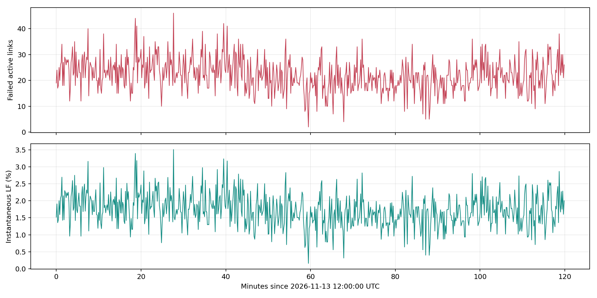
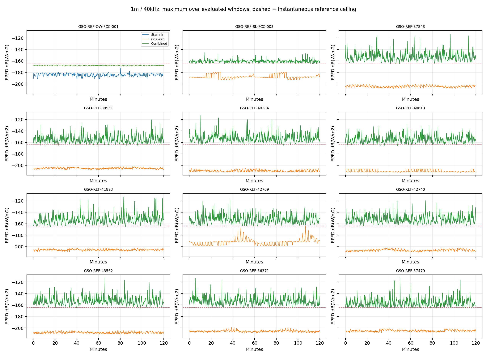
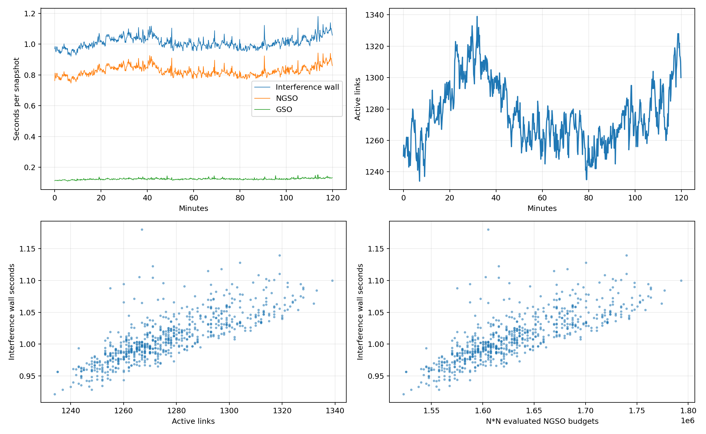

# V1.5 两小时逐快照开环完整计算基准

日期：2026-11-17。站内随机分频不允许重频，由用户明确确认。V1.4.1及原feeder_v1保持不变。

## 场景与口径

使用既有three_constellations场景：218个Starlink站点、13个OneWeb站点、12条原GSO固定保护关联。轨道候选分别10611、651、12条，Starlink文件并非严格Gen1身份筛选结果。保留既有站点来源、社区近似位置及人工仿真点；未确认真实运营状态。没有下载或扩充新数据。

UTC从2026-11-13T12:00:00Z至13:59:50Z，10秒采样，720个起点快照；不另算7200秒终点。初始轨道epoch偏移见audit.json，全程最大绝对偏移4.101773天；传播错误样本0。沿用Starlink 300–650km、OneWeb 1100–1300km瞬时高度筛选，不声称运行状态筛选。

同运营商、网关ID升序轮询，最高仰角优先，同仰角按卫星ID；仰角至少40°，每站最多8条，每星最多1条。每站8频道无放回随机分配、站间复用；种子20261115，SHA256(seed/frame/gateway)前128位大端构造PCG64随机流。实际频道写入每帧输入。

使用原12dBW/100MHz载波、398K、I/N严格大于−12.2dB判失效；S.1528-0和S.1428-1参数保持。GSO使用1/2/5m、30个既定窗口，Starlink/OneWeb/合计分别保存。完整逐对预算采用原标量公式的数组求值，没有弱项筛选、时间复用、预测或反馈优化。

## 结果

- 活动链路：1234–1339条/帧。
- 失败链路样本：15917 / 活动链路样本919102。
- 主汇总LF：1.73179908%；逐帧LF均值：1.73027041%。均不是连续时间失效时长比例。
- 1m/40kHz/合计的已评价窗口全程峰值：-112.029695dB(W/m²)，第395帧，GSO-REF-43562；超过匹配100%时间瞬时参考上限的接收点快照样本数为7710（不是连续超限时长）。完整18种口径/带宽/系统峰值见completed_validation.json。
- 站内无重频使同站干扰在理想零邻频泄漏模型下为零，这是基线规则的结果，不能解释为真实设备不存在同站干扰。

## 计时

单调高精度perf_counter，顺序单进程，未主动预热，首帧计入；平台、依赖版本与线程环境见config.json，未强制设置数值库线程数。整体干扰wall time直接测量，包含数组准备、全部逐对几何、方向图、功率、聚合和指标统计。传播、选星、分频、输入/结果I/O、额外独立验证分别记录；网页绘图不计入。输出snapshot_s是快照处理时间，不含启动加载及最终报告生成。分项求和不代替wall time。本轮在日常桌面环境运行，期间有短时测试、抽样重建和浏览器验证活动，未隔离系统负载；这些耗时作为初始规模测量，不作为严格隔离条件下的算法加速比或实时保证。

| 项目（秒） | 总和 | 均值 | 中位数 | P95 | 最大值 |
|---|---:|---:|---:|---:|---:|
| propagation_s | 5.823 | 0.008088 | 0.007911 | 0.009588 | 0.016642 |
| association_s | 336.602 | 0.467502 | 0.465929 | 0.497557 | 0.639283 |
| random_s | 19.967 | 0.027732 | 0.027594 | 0.028965 | 0.040707 |
| input_io_s | 40.369 | 0.056068 | 0.058172 | 0.060481 | 0.091177 |
| shared_s | 1.043 | 0.001449 | 0.001428 | 0.001743 | 0.002912 |
| ngso_s | 594.178 | 0.825247 | 0.819573 | 0.883833 | 0.942879 |
| gso_s | 89.462 | 0.124252 | 0.123680 | 0.132676 | 0.151183 |
| aggregation_s | 42.871 | 0.059543 | 0.059107 | 0.064003 | 0.094044 |
| interference_s | 727.556 | 1.010494 | 1.005271 | 1.077878 | 1.180404 |
| validation_s | 0.561 | 0.000779 | 0.000001 | 0.000001 | 0.560083 |
| result_io_s | 14.888 | 0.020677 | 0.019421 | 0.033738 | 0.036026 |
| snapshot_s | 1152.576 | 1.600800 | 1.594761 | 1.684050 | 2.128075 |

N*N包含期望信号对角预算，N*(N−1)为非自身有序干扰对；cochannel_pairs为其中同频对，visible_cochannel_pairs为地平线上同频有效对。GSO同时记录12*N几何对、3*12*30*N窗口源槽数及实际有贡献槽数。槽数不等于独立几何计算次数。

## 图与回放







执行`.venv-ems/Scripts/python.exe scripts/serve_feeder_openloop_v1_5.py`，访问`http://127.0.0.1:8765/experiments/feeder_openloop_v1_5/`。页面提供播放/暂停、跳转、系统/站点/连线筛选、口径/带宽/系统贡献切换，所有指标来自预计算结果；解压逐帧输入需支持DecompressionStream的现代浏览器。

## 验证与复现

新增4项测试：方向图分段及边界对照标量模型；原61帧输入中0/30/60帧完整矩阵对照；随机流站点独立且无重频；原12条GSO关联完全保留。首帧另检查3个受扰链路对全部源的标量预算，以及3颗卫星批量传播与既有Skyfield传播一致性。全720帧审计频道、唯一性、仰角、GSO可见性、失效ID/计数、777600条窗口系统线性贡献求和。

输入保存在input_XXX.json.gz，结果保存在result_XXX.json，window_epfd.csv.gz保留每帧全部窗口系统贡献；只保存首帧完整矩阵，其余可从输入和config重建。无需重跑传播/选星来比较后续算法。

复现命令（输出目录必须不存在，禁止覆盖）：

```powershell
.venv-ems/Scripts/python.exe scripts/run_feeder_openloop_v1_5.py --frames 3 --out results/feeder_openloop_v1_5_pilot_new
.venv-ems/Scripts/python.exe scripts/run_feeder_openloop_v1_5.py --frames 720 --out results/feeder_openloop_v1_5_new
.venv-ems/Scripts/python.exe -m pytest tests/test_feeder_openloop_v1_5.py -q
```

文件哈希见manifest.json，实现及模型源码哈希见completed_validation.json。V1.5是派生研究基准，当前未创建独立冻结快照。

保护线只作为匹配配置的100%时间瞬时参考上限：40kHz −164、1MHz −150dB(W/m²)。单系统与合计分别关联Article22表22-1B及第76号决议表1B，不据此宣称完整曲线或真实运营系统合规。当前未做槽内细采样、全球最坏几何或长期统计；也未实现快速近似算法。下一步可在相同保存输入上测量瓶颈，设计并比较快速算法的误差、漏检与耗时。

## 最高峰专项复核

对第395帧1m/40kHz全程峰值进行了独立逐源标量公式复核，与窗口模型一致（绝对容差1e-10dB）。主导源为feeder:starlink:starlink-35111:SL-C-071，发射离轴0.000000°、GSO接收离轴0.195524°，斜距488.169754km，贡献占比99.99999951%。该保护接收点与该源服务网关在本场景中同址；接近GSO接收主轴的活动下行束导致强峰值。当前无GSO避让或反馈管理，因此这种几何没有被主动排除。复核只确认本模型预算，不确认真实设备或实际同址运行。详见peak_scalar_validation.json。
