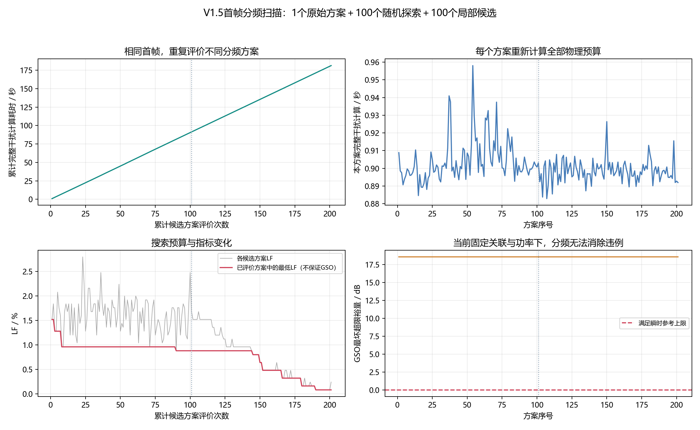
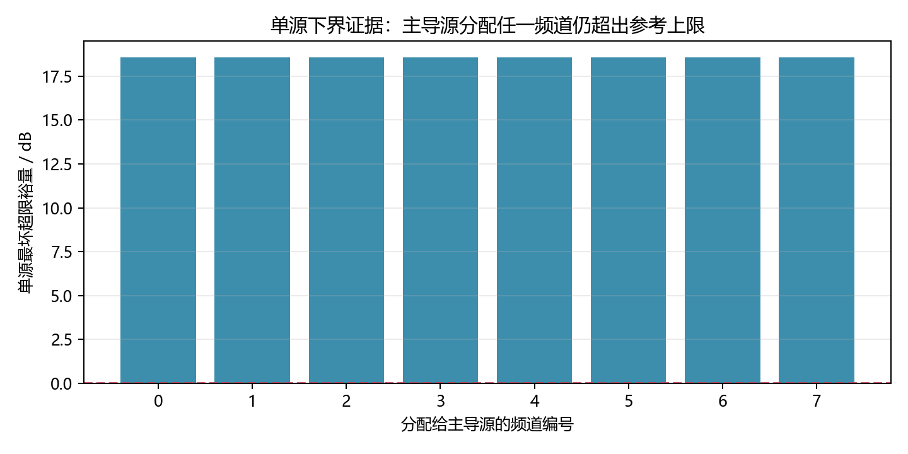

# 周报素材：V1.5首帧子信道分配扫描

周会日期：2026-11-18。实验完成日期：2026-11-17。

## 一句话结论

同一个卫星几何快照，在分频决策中可以需要评价大量不同资源配置。本次明确设置201次候选评价预算，逐候选完整重算耗时181.17秒，平均0.901秒/方案。评价次数并非所有优化算法的必需次数；它由搜索方法、预算、收敛规则和约束可行性共同决定。

## 已冻结的基础

V1.5冻结目录：baselines/feeder_v1_5_20261117，24项相关测试通过。保留两小时720帧完整开环基准、代码、输入、结果、测试、环境及哈希。此次扫描是独立派生实验，不改写冻结版、原两小时结果和既有V1.5可视化。

## 本次固定与改变的量

- 固定UTC：2026-11-13T12:00:00Z；固定1250条最大仰角活动关联、位置、天线、12dBW功率及全部研究物理假设。
- 仅改变8个子信道的分配；230个活动网关内不重频，站间复用。
- 初始方案1个、独立随机分配100个、基于当前最优解的局部候选100个，总计201个互不相同的合法分配。
- 候选更新规则：站内交换两个频道，或改用站内空闲频道；局部搜索交替选取失败链路所在站点与随机站点。随机种子20261117。
- 采用可行优先规则：若满足全部GSO瞬时参考上限，则减少NGSO失败链路；不可行方案按最坏GSO超限dB、违例接收配置数、NGSO失败链路数排序。未证明收敛或全局最优。
- GSO研究约束：12站、1/2/5m、40kHz和1MHz、30个已评价窗口，两系统合计分别对照−164/−150dB(W/m²)。评价的是匹配配置的100%时间瞬时参考上限，不是完整长期合规判定。

## 实测结果

| 项目 | 结果 |
|---|---:|
| 实际候选评价次数（含原始方案） | 201 |
| 完整干扰计算累计耗时 | 181.175秒 |
| 单方案均值 / P95 | 0.901366 / 0.917701秒 |
| 原始失败链路 / LF | 19 / 1.5200% |
| 全部候选中最低失败数 / LF（不保证GSO） | 1 / 0.0800% |
| 满足全部GSO研究门限的候选 | 0 |
| 原始分配的一轮完整局部邻域 | 5510个候选 |
| 按实测单次均值外推一轮完整邻域（未实际枚举） | 4966.5秒，约82.8分钟 |

## 不是“多试几次就能满足约束”

不仅201个候选未找到可行分配，还获得了固定关联、固定功率条件下的单源不可行证据：feeder:starlink:starlink-31649:SL-C-165。对其8个频道逐一计算独立贡献，最小的最坏超限裕量仍为18.565628dB。聚合贡献非负，因此其他源无法抵消它。

这说明在上述12站、全部窗口和参考口径保护要求下，任何仅分频方案都无法完全满足门限。频道调整将主导干扰移到另一个被评价窗口，而不是移出保护频段。该结论仅适用于当前假设模型、固定活动关联和功率，不代表真实运营系统违规，也不证明引入换星、暂停链路或功率控制后的问题不可行。

## 周会上可以怎么说

> 我们已完成并冻结异构星座两小时720快照的完整干扰评价基准。单个既定配置约1秒，但一个决策需要评价多少次，取决于优化器。本次在同一首帧实际扫描201个合法分配，累计完整干扰计算约181秒。一个常用站内交换/空闲频道调整邻域就有5510个候选，如果全部采用当前完整重算实现，一轮估计约83分钟。因此，需要研究面向决策过程的高效干扰评价和动态更新。同时，单源下界表明本帧仅靠分频不能完全满足GSO保护，需要先明确后续允许的管理动作。

## 必须保留的比较边界

1. 201是实验预算，不是证明一次决策至少必须算201次；5510是指定完整邻域的大小，不代表任何优化器都要枚举。
2. 本次是同一静态几何下的重复方案评价，还不是跨时刻动态算法，也不是连续时间闭环。
3. 当前逐候选重算包括NGSO全部N×N几何、方向图、功率，及GSO全部参考窗口、聚合指标；不缓存几何、不做近似。I/O、候选生成及预先进行的8次单源响应诊断不计入候选干扰累计时间，分别记录。
4. 固定几何下的精确缓存、确定零贡献排除等工程优化可能大幅降耗；本实验不能证明AI或近似不可替代，后续需要加入强精确对照。
5. 目标中的GSO最坏裕量差别可能很小，LF最低方案不一定是可行优先目标最优方案。两者分别报告，不混用。
6. 合法分配空间约为10^855.89量级，只用于说明组合规模；绝不能按该数量乘单次耗时，声称是实际算法开销。

## 复现与文件

`scripts/scan_feeder_first_frame_v1_5.py`读取冻结快照首帧，输出到results/feeder_first_frame_scan_20261117；输出目录存在时拒绝覆盖。candidate_results.npz保留全部201个实际频道向量、逐链路I/N和全窗口三系统贡献；candidates.csv保留逐次指标、阶段、最优解接受情况和直接计时。原始输入、配置、单源证据、验证和哈希同目录保存。
